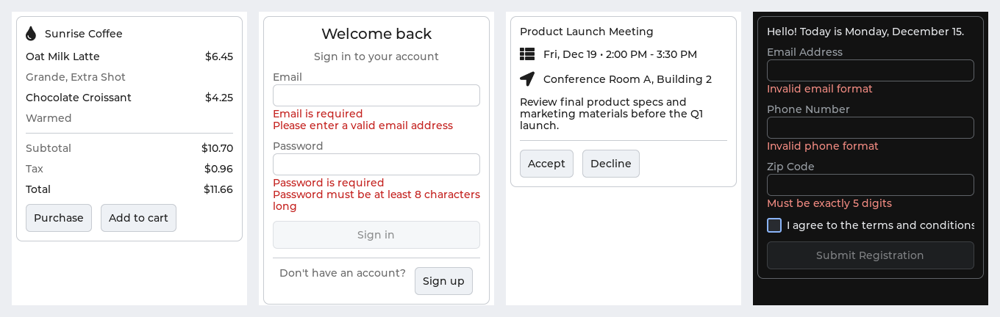

# a2ui-lvgl

[](https://github.com/faluciano/a2ui-lvgl/actions/workflows/ci.yml)
[](LICENSE)


An [A2UI](https://github.com/a2ui-project/a2ui) v1.0 renderer for
[LVGL](https://lvgl.io) on microcontrollers. An AI agent describes a screen in
JSON, and an ESP32 draws it with native LVGL widgets and sends the user's
actions back. The firmware stays the same whatever the agent shows.



*Upstream A2UI examples drawn by this library with LVGL at 320x400, light and
dark theme. These are host renders (`make renders`), not photos of a device.*

## Status

**Pre-release (0.1.0).** It runs on an ESP32-P4 board. Everything is also
tested on a Linux host against the upstream A2UI test suites, and the device
build is compile-checked for four chips. Other chips and displays have not
been tried yet; please
[report what you find](https://github.com/faluciano/a2ui-lvgl/issues).

| Check | Result |
|---|---|
| A2UI core conformance (v1.0 cases) | 672 pass, 0 fail, 1 documented exception |
| A2UI framework adapter conformance | 36 of 36 |
| Unit tests | 99, plus 107 LVGL adapter checks |
| ESP-IDF v6.0 builds | ESP32, ESP32-S3, ESP32-C3, ESP32-P4, no warnings |

Details, including what is skipped and why, are in
[docs/conformance.md](docs/conformance.md).

## What you get

- **`a2ui_core`**: the protocol in portable C++17, with no UI dependency. It
  handles messages, the data model, catalogs and schema validation, data
  binding, the 14 standard functions, and function calls between device and
  agent. Number, currency and date formatting are built in for 16 locales, so
  the device needs no ICU.
- **`a2ui_lvgl`**: all 18 components of the A2UI basic catalog as LVGL 9
  widgets, a theme, and hooks for images, an on-screen keyboard and
  accessibility. You can replace any component with your own widget.
- **`examples/basic_surface`**: an ESP-IDF app for SPI displays (ST7789,
  ILI9341) or no display at all.

Both libraries build without exceptions or RTTI and run on a single thread,
the LVGL task.

## Try it without hardware

You need `git`, `make`, a C++17 compiler and [uv](https://docs.astral.sh/uv/)
(used to convert the upstream YAML test suites).

```sh
git clone --recurse-submodules --shallow-submodules https://github.com/faluciano/a2ui-lvgl.git
cd a2ui-lvgl
make test      # unit tests and the upstream conformance suites
make renders   # draws every upstream example into build/renders/*.png
build/host/render_sample my_surface.json out.png --size 320x240 --dark
```

`render_sample` takes any file of A2UI v1.0 messages, so you can check what
your agent's output looks like before you flash anything.

## Use it on an ESP32

Build the example (ESP-IDF 6.0; see [Requirements](#requirements)):

```sh
cd examples/basic_surface
idf.py set-target esp32s3
idf.py menuconfig   # "A2UI basic surface example": display, controller, pins
idf.py build flash monitor
```

To use the libraries in your own project, add them from the
[ESP Component Registry](https://components.espressif.com/components/faluciano/a2ui_lvgl):

```sh
idf.py add-dependency "faluciano/a2ui_lvgl^0.1.0"
```

That also brings in `a2ui_core` and LVGL. To track this repository instead,
use a git dependency in `main/idf_component.yml`:

```yaml
dependencies:
  faluciano/a2ui_lvgl:
    git: https://github.com/faluciano/a2ui-lvgl.git
    path: components/a2ui_lvgl
    version: main
```

Then, from the LVGL task:

```cpp
#include "a2ui/basic_catalog.h"
#include "a2ui/message_processor.h"
#include "a2ui/spec_documents.h"
#include "a2ui_lvgl/a2ui_lvgl.h"

// The standard catalog, with its functions.
auto catalog = a2ui::Catalog::from_json(
    *a2ui::spec::parsed(a2ui::spec::Document::BasicCatalogV1)).value();
a2ui::basic_catalog::bind_functions(*catalog);

// Every message for the agent goes out through your transport.
a2ui::MessageProcessorOptions options;
options.forward_actions = true;  // include the user's actions
options.outbound_listener = [](const a2ui::Json& message) {
  send_to_agent(message.dump());
};
a2ui::MessageProcessor processor({catalog}, std::move(options));

// Feed each message that arrives from the agent.
processor.process_text(json_from_agent);

// Draw a surface once the agent has created it.
a2ui_lvgl::SurfaceConfig config;
config.registry = &a2ui_lvgl::basic_registry();
a2ui_lvgl::Surface view(*processor.model().get_surface("main"),
                        lv_screen_active(), config);

for (;;) {
  processor.tick(esp_timer_get_time() / 1000);  // agent call timeouts
  lv_timer_handler();
}
```

[docs/adapter.md](docs/adapter.md) covers the adapter in full: custom
components, the theme, the image loader and the other hooks.

### What you provide

- **The connection to the agent.** The library takes and returns JSON text.
  WebSocket, HTTP streaming, MQTT, BLE or a serial port all work. A ready-made
  WebSocket transport is on the [roadmap](#roadmap).
- **An image loader**, if you want `Image` components to show pixels.
- **Fonts**, if you want bold, italic or glyphs beyond the built-in Montserrat.

## Use it with plain CMake

Outside ESP-IDF, add the repository and link the targets. `a2ui::lvgl` is
defined when an `lvgl` target exists first.

```cmake
add_subdirectory(third_party/lvgl)        # your LVGL 9.6, with your lv_conf.h
add_subdirectory(third_party/a2ui-lvgl)
target_link_libraries(app PRIVATE a2ui::core a2ui::lvgl)
```

The core alone (`a2ui::core`) has no dependencies, so it also suits a renderer
for a different UI toolkit. [docs/porting.md](docs/porting.md) lists what a
new platform needs.

## Requirements

| | |
|---|---|
| A2UI | v1.0 messages and the v1.0 basic catalog. v0.8 and v0.9 are not supported. |
| LVGL | 9.6 or later |
| ESP-IDF | 6.0 (tested with v6.0.3). 5.4 and 5.5 are untested. |
| Compiler | C++17 (GCC or Clang) |
| Flash | About 1 MB for the example image; use a 1.5 MB or larger app partition |
| RAM | See below |

### Memory

Measured in Espressif's QEMU emulation of the ESP32-S3 and ESP32-C3. The
library runs on an ESP32-P4 board, but these figures have not been measured
on hardware yet.

| What | Heap | Stack |
|---|---|---|
| Basic catalog, loaded once | about 220 KB | 5 KB |
| A typical card, with its LVGL widgets | about 80 KB | 9 KB |
| A message at the default depth limits | | 36 KB |

You need an **ESP32-S3 or ESP32-P4 with PSRAM**. Nearly every allocation is
small, so ESP-IDF puts it in internal RAM first unless you change
`CONFIG_SPIRAM_MALLOC_ALWAYSINTERNAL`. Chips without PSRAM (ESP32-C3, plain
ESP32 modules) build, but an ESP32-C3 ran out of memory rendering a typical
card; a compact catalog for them is on the roadmap.
[docs/porting.md](docs/porting.md#memory-on-esp-idf) explains how to keep
the libraries in PSRAM and how much stack to give the A2UI task.

## Limitations

- `Video` and `AudioPlayer` render nothing. Register your own component to
  show a poster or a player.
- `Image` shows a placeholder until your image loader delivers pixels.
- The built-in fonts have no bold or italic, and no emoji.
- Long text inside a `Row` does not wrap (LVGL flex items do not shrink).
- A regular expression with an unanchored lookahead, such as `(?=.*x)`, takes
  time proportional to the square of the input length (inputs are capped at
  4,096 characters).

The full list is in [docs/adapter.md](docs/adapter.md#limitations).

## Roadmap

1. Publish memory and frame rates measured on real boards.
2. A WebSocket transport and an end-to-end example with a sample agent.
3. A compact, precompiled basic catalog for chips without PSRAM.
4. An SDL desktop simulator.

## Contributing

Bug reports, board test results and pull requests are welcome. Start with
[CONTRIBUTING.md](CONTRIBUTING.md). To report a security problem, see
[SECURITY.md](SECURITY.md).

## Repository layout

| Path | Contents |
|---|---|
| `components/a2ui_core` | Protocol core. No dependencies. |
| `components/a2ui_lvgl` | LVGL adapter. Depends on `a2ui_core` and LVGL. |
| `examples/basic_surface` | ESP-IDF example app. |
| `test/` | Unit tests, the conformance harness and the LVGL adapter tests. |
| `tools/` | Host renderer, table generators and build scripts. |
| `docs/` | Adapter guide, porting notes, conformance details. |
| `third_party/a2ui` | Upstream A2UI (submodule): specification, catalogs, conformance suites. |
| `third_party/lvgl` | LVGL v9.6.0 (submodule), used only for host builds. |

## License

Apache License 2.0. See [LICENSE](LICENSE) and [NOTICE](NOTICE).

A2UI is a project of Google LLC and the A2UI authors. LVGL is a project of
LVGL Kft. This is an independent community project, not affiliated with or
endorsed by either.
